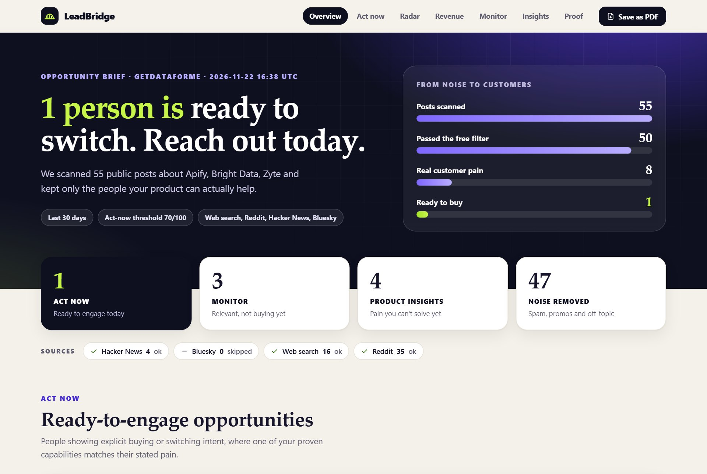
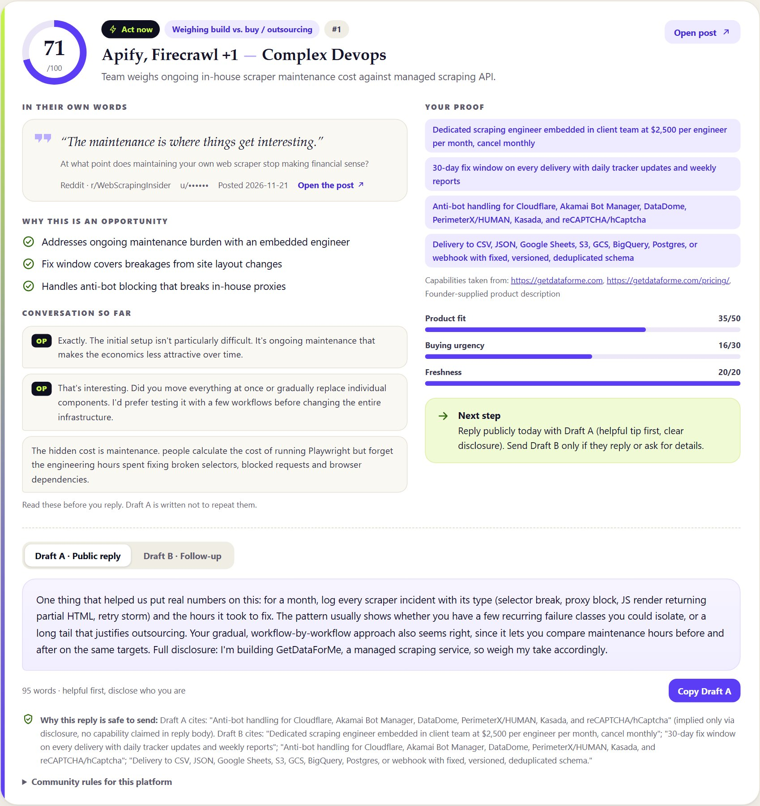
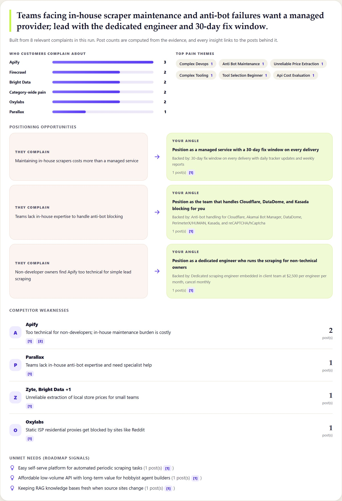
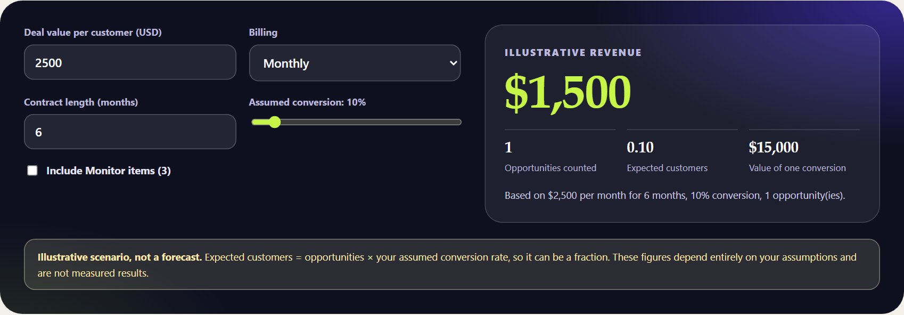

# LeadBridge: Find Customers Leaving Your Competitors

**For B2B SaaS, DevTool and service founders who don't have a sales team or a social-listening budget.**

Every day, people post on Reddit and other forums that they're fed up with a tool and want something else. A few of them are your next customers. LeadBridge finds them, checks they're real, and tells you exactly what to say.

Give it **your website address** and nothing else. It reads your site to learn what you sell, finds fresh complaints about your competitors, keeps only the people **your product can actually help** and who **show buying intent**, and hands you an evidence-backed brief.



You pay for opportunities, not for thousands of mentions.

## See it in action

**Every opportunity is a conversation, not a row in a table.** You get the person's own words, why they're a fit, your proof, what others already replied, and two ready-to-review drafts.



**The Competitor Pain Radar turns scattered complaints into positioning.** Each insight links to the posts behind it.



**A revenue calculator shows what the opportunities could be worth under your own assumptions.** It is clearly labelled as an illustration, never a forecast.



## How it works

1. **Profile:** reads your homepage and pricing page, then builds a list of capabilities it can prove from your own site. It picks your competitors and the search queries to use.
2. **Harvest:** searches Google, Reddit, Hacker News and Bluesky for recent complaints and "looking for an alternative" posts.
3. **Free filter:** removes duplicates, cross-posts, profile pages, spam, your own brand and old posts before any AI cost.
4. **Read the conversation:** for Reddit threads, it reads the full post and the top replies. That shows whether the person already solved their problem, and what others already said.
5. **Qualify:** an AI checks every post. Is it a real person with a real problem? Does one of your capabilities fix it? Are they ready to switch? Ads, listicles and launch posts are rejected.
6. **Deliver:** drafts replies that add something new, builds the Competitor Pain Radar, and writes an HTML report and a PDF.

**What keeps it honest**
- A lead is **Act now** only when the person shows real buying intent, not just a high score.
- Quotes are kept only if they appear word for word in the post.
- Competitor names are kept only if the post or its replies actually mention them.
- Replies may only mention capabilities found on your own website.
- Radar insights must link to the posts they're based on; anything without evidence is dropped.
- It never posts anything for you. You review and send.

## Input

Only **Product Website URL** is required (your website address, such as `https://your-product.com`, not the product name). Everything else is optional:

| Field | What it does |
|---|---|
| `productUrl` | Your homepage (required). |
| `productName`, `productDescription` | Optional. The name is read from your site; add a description only if your site can't be read. |
| `competitors` | Competitors you already want watched. Others are found automatically. |
| `sources` | Google, Reddit, Hacker News, Bluesky, and optionally G2 reviews. |
| `lookbackDays` | How far back to look (default 14; 30 finds more). |
| `minWinabilityScore` | Score needed for Act now (default 70). |
| `tone` | Voice of the drafted replies. |
| `dealValueUsd`, `billingPeriod`, `contractMonths`, `assumedConversionRatePercent` | Optional, for the revenue calculator. |
| `modelName` | AI model, run through Apify's OpenRouter proxy (default Claude Haiku 5.5). No separate AI key needed. |

```json
{ "productUrl": "https://your-product.com", "competitors": ["Competitor A"], "lookbackDays": 30 }
```

## Output

- **Dataset:** one row per opportunity (Act now, Monitor, Product insight), with two table views: *Opportunities* and *Outreach drafts*. Export as JSON, CSV or Excel.
- **Key-value store:**
  - `REPORT.html`: the interactive report (open it in your browser)
  - `REPORT.pdf`: the same report, ready to share
  - `COMPETITOR_RADAR`: competitor weaknesses, positioning angles, unmet needs
  - `REVENUE_SCENARIO`: illustrative scenario, calculated only when you give a deal value
  - `STATUS`: run summary

One opportunity in the dataset looks like this (real output, drafts trimmed):

```json
{
  "priority": "Act now",
  "winabilityScore": 71,
  "intentLabel": "Weighing build vs. buy / outsourcing",
  "competitorMentioned": "Apify, Firecrawl, Bright Data",
  "painSummary": "Team weighs ongoing in-house scraper maintenance cost against managed scraping API.",
  "intentEvidenceQuote": "The maintenance is where things get interesting.",
  "opportunityReasons": [
    "Addresses ongoing maintenance burden with an embedded engineer",
    "Fix window covers breakages from site layout changes",
    "Handles anti-bot blocking that breaks in-house proxies"
  ],
  "matchedCapabilities": [
    "Dedicated scraping engineer embedded in client team at $2,500 per engineer per month, cancel monthly",
    "30-day fix window on every delivery with daily tracker updates and weekly reports"
  ],
  "capabilitySources": [
    "https://getdataforme.com",
    "https://getdataforme.com/pricing/"
  ],
  "threadReplies": [
    "[OP] Exactly. The initial setup isn't particularly difficult. It's ongoing maintenance that makes the economics less att...",
    "[OP] That's interesting. Did you move everything at once or gradually replace individual components. I'd prefer testing..."
  ],
  "recommendedAction": "Reply publicly today with Draft A (helpful tip first, clear disclosure). Send Draft B only if they reply or ask for details.",
  "draftPublicReply": "One thing that helped us put real numbers on this: for a month, log every scraper incident with its type (selector break, proxy block, JS render returning partial HTML, retry storm) and the...",
  "postUrl": "https://www.reddit.com/r/WebScrapingInsider/comments/1y23gfz/at_what_point_does_maintaining_your_own_web/"
}
```

## Use it from an AI agent or your code

**API** (runs take about 3 to 4 minutes, so start a run and fetch the dataset when it finishes):

```bash
curl -X POST "https://api.apify.com/v2/acts/<username>~leadbridge/runs" \
  -H "Authorization: Bearer <APIFY_TOKEN>" -H "Content-Type: application/json" \
  -d '{"productUrl": "https://your-product.com"}'
```

**MCP:** add the Apify MCP server (`https://mcp.apify.com`) to Claude, Cursor or any MCP client, and your agent can run LeadBridge as a tool.

**Schedule it:** use Apify Schedules to run it weekly. (LeadBridge doesn't yet remember earlier runs, so each run reports everything it finds in the window.)

## Pricing

Pay per event. You only pay for work done:

| Event | Price | When it's charged |
|---|---|---|
| Product analyzed | $0.05 | Once per run, after your product is profiled |
| Complaint qualified by AI | $0.005 | Per post the AI checks (after the free filter) |
| Act-now opportunity | $0.50 | Per qualified opportunity delivered with drafts |
| Actor start | $0.00005 | Run start (tiny) |

**A typical run:** about 45 to 55 posts checked and 1 to 3 Act-now opportunities, so roughly **$0.80 to $1.80**. A run that finds no Act-now opportunity costs about $0.30.

*Apify's pricing card shows the headline price per 1,000 results (for example $500 per 1,000 Act-now opportunities). That is just $0.50 each.*

You can set a maximum cost per run in Apify, and LeadBridge stops delivering opportunities when it is reached. LeadBridge also runs Apify Store scrapers (Google search, Reddit) and AI calls on your account. In our test runs, the platform usage shown on the run page was roughly $0.03 to $0.07.

## FAQ

**Does LeadBridge post replies for me?** No. It never posts anything. You review the drafts, edit them, and send them yourself.

**How many opportunities will I get?** It depends on how much people are complaining publicly in your category. In our test runs, 45 to 60 posts passed the free filter and 1 to 3 became Act-now opportunities. Some runs find none. LeadBridge doesn't pad results with weak leads. A longer lookback window and naming your competitors in the input both help.

**Which sites does it search?** Google results, Reddit, Hacker News and Bluesky. Bluesky is best-effort and is often unavailable without a login, so expect most results from Reddit and Google.

**My website is built with JavaScript and won't load. What happens?** LeadBridge falls back to a browser crawler. If your site still can't be read, add a short `productDescription` and it will use that.

**Is it okay to reply to these people?** LeadBridge only reads public posts, and it writes drafts that lead with help and clearly disclose who you are. Each opportunity shows the community's own rules. You are responsible for following each platform's terms and your local privacy rules.

**Can I change the AI model?** Yes: set `modelName` to another model available through Apify's OpenRouter proxy. The default is Claude Haiku 5.5.

**Who is it for?** It works best for B2B software and services whose website clearly states what they offer. It is not built for consumer brands.
